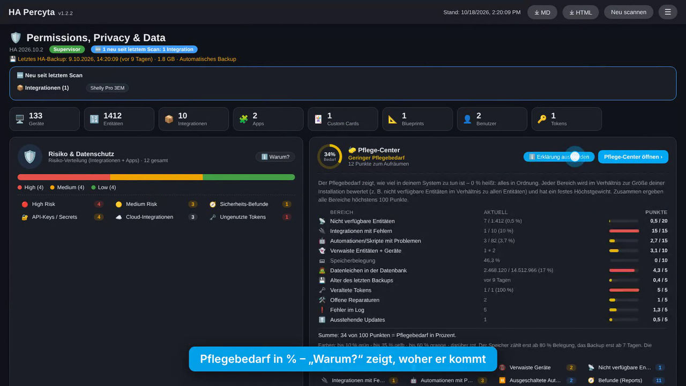
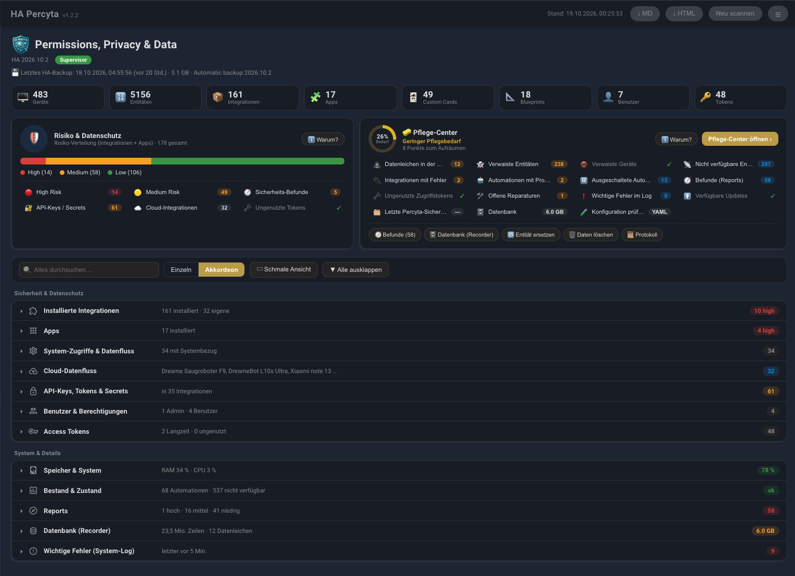
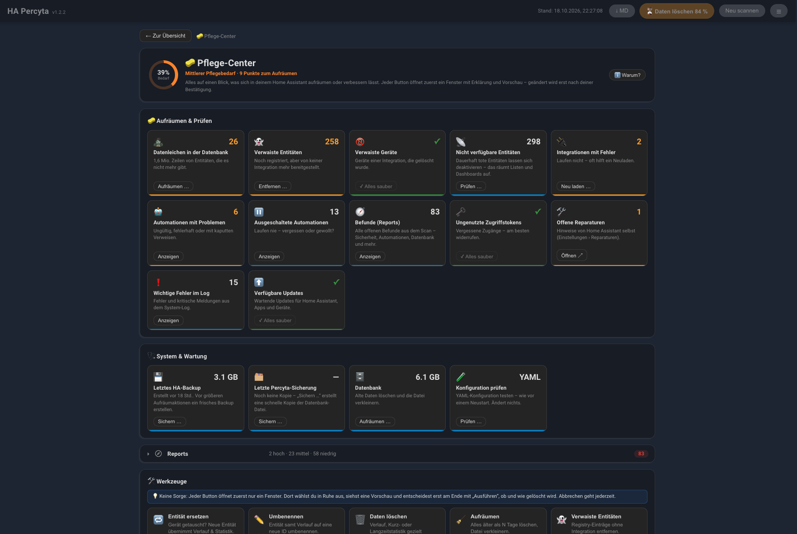
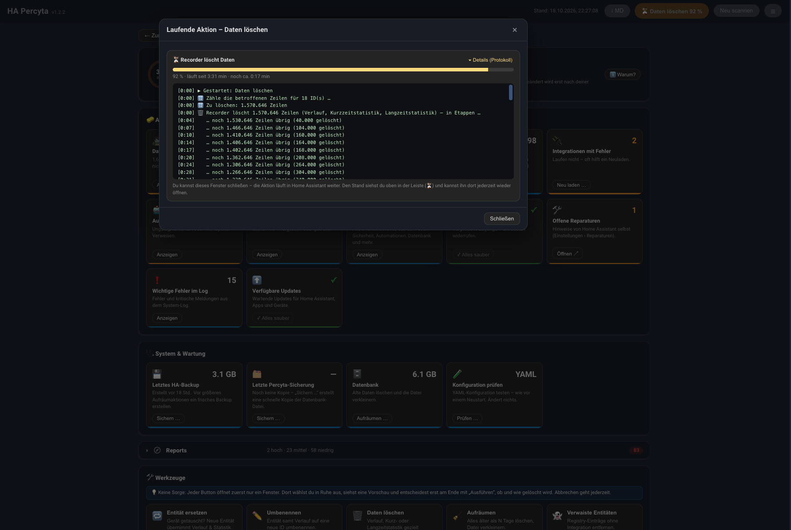
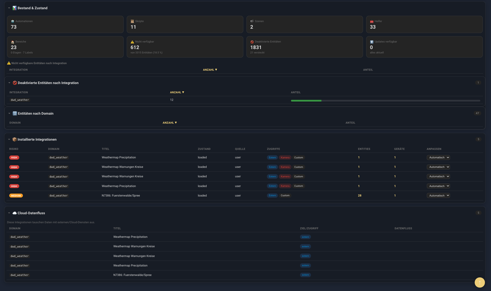

<p align="center">
  
</p>

<h1 align="center">HA Percyta</h1>

<p align="center">Home Assistant Permissions, Privacy &amp; Data Scanner</p>

<p align="center">
  <a href="https://hacs.xyz"></a>
  <a href="https://github.com/jayjojayson/HA_Percyta/releases"></a>
  <a href="https://github.com/jayjojayson/HA_Percyta/actions/workflows/validate.yml"></a>
  <a href="https://github.com/jayjojayson/HA_Percyta/releases"></a>
  <a href="https://github.com/jayjojayson/HA_Percyta/blob/main/LICENSE"></a>
  <a href="docs/README_de.md"></a>
  <a href="README.md"></a>
</p>

**Home Assistant integration** – scans **locally** all integrations, apps,
custom cards, blueprints, users, tokens and stored API keys/secrets, and evaluates
system access (GPS, camera, root/supervisor …). Since **v1.1.x** it also captures
**disk space, CPU and RAM usage**. Since **v1.2.2** it is also a **maintenance tool**: the care center,
automation findings and database tools let you inspect, clean up and maintain your whole Home Assistant
system from one panel.

> Runs entirely **inside** Home Assistant and reads all data directly via the internal
> `hass` object. **No token and no URL required.**
> Scans are **read only**. Changes only happen through the **action buttons** added in v1.2.2
> (database tools, removing orphaned entities, revoking tokens, turning automations on/off) –
> and only when you start them yourself, with confirmation and (where it matters) a backup first.

## Demo video (30 s)

<p align="center">
  <a href="docs/percyta_demo.mp4"></a>
  <br><sub>▶ Click to play <code>docs/percyta_demo.mp4</code> – maintenance need with “Why?”, care center, the compact box list, automation findings, database clean-up with live progress, log errors with diagnosis, secured secrets</sub>
</p>

## Screenshots

<p align="center">
  
  <br><sub>Overview: key figures, risk distribution and all sections at a glance</sub>
  <br><br>
  
  <br><sub>Storage &amp; System: disk, RAM, CPU and the largest storage consumers</sub>
  <br><br>
  
  <br><sub>Global search across all tables and sections</sub>
  <br><br>
  
  <br><sub>Inventory &amp; integrations with risk rating and manual override</sub>
</p>

## Features

- **🧭 Reports** – turns the scan into a to-do list: every finding comes with an
  **observation, possible cause, impact and step-by-step instructions**, plus a button that
  jumps to the right place in Home Assistant. Clicking a finding opens a **detail view**
  (diagnosis, affected objects, technical data, previous/next finding). Findings are
  grouped by common cause (e.g. an integration that is not running instead of dozens of
  single unavailable entities) and sorted by severity. Covered:
  - **Security & privacy** – unused long-lived tokens, integrations rated high risk, apps with
    far-reaching rights, stored credentials (notice), backup missing/outdated.
  - **🤖 Automations & scripts** (new in 1.2.2) – answers *“which automations don't run, and why?”*:
    - **Invalid configuration** – Home Assistant rejected it on load (incl. the exact error message,
      e.g. a missing blueprint or a misspelled trigger); it is “unavailable” and never runs.
    - **Errors while running** – the last run aborted with an error (from the stored traces:
      message, failing step, time; link straight to the trace).
    - **Runs skipped** – triggered while still running (mode `single`/max reached), so triggers got lost.
    - **Problematic references** – per automation/script: entities that do **not exist**, are
      **disabled**, **orphaned** or **unavailable**, deleted **devices** and **areas**, **unknown actions**
      (e.g. a deleted script or an uninstalled integration) and entities used in **templates**
      (`states('…')`, `is_state(…)`, `states.domain.object` …) – each with the part (trigger,
      condition, action) and the exact location. Missing entities link to the matching
      *broken reference* finding.
    - **Turned off** – automations that are switched off and therefore never run.
    - **Not triggered for 90+ days** – now with the reason from the traces when the trigger fired but
      the conditions blocked it.
  - **Broken references** – automations/scripts that point to entities which do not exist
    (with the exact location in the configuration), integrations that are not running.
  - **Unused & orphaned** – unavailable entities per integration, orphaned entities (still
    registered, no longer provided).
  - **Storage & upkeep** – storage almost full, database hotspots, **orphaned database data**
    (history/statistics of entities that no longer exist), updates available.
  - **Manage:** mark as *allowed*, *snooze* (7/30/90 days), *hide* or *reopen* – for single
    findings or a whole selection, with an optional note. Status is stored **only in
    HA Percyta**; nothing is changed in Home Assistant. A collapsible note *“What do Open, Allowed, Snoozed and
    Hidden mean?”* in the box explains each status: **Open** = new or still existing; **Allowed** = checked and
    consciously accepted, no longer counted as open but still checked with every scan; **Snoozed** = put aside for
    7/30/90 days, then open again if the problem still exists; **Hidden** = hidden until you reopen it. Once a problem is
    really fixed, the finding leaves every status with the next scan and appears under *Recently resolved*.
  - **Affected objects** in the finding details: the **ID is clickable** – entities open their Home Assistant
    detail dialog (settings, history), devices and areas their HA page; a **copy button** copies the ID.
    *Open in Home Assistant* and the ID links are real links – right-click or Ctrl/Cmd-click opens them in a
    new tab (for entities: their history), so you can stay in HA Percyta.
  - **Recently resolved (last 30 days)** – every entry is **clickable** (new in 1.2.2): it shows what
    the problem was, the affected objects *as they were* incl. a **“Now”** column with their current
    state, the technical data and a **history timeline** (first observed → which objects were added or
    fixed over time → resolved), plus how long the finding existed. Open findings have the same
    **History** tab.

- **🧽 Care center** – the maintenance view of your system: a **maintenance need** score (0 % = all fine)
  relative to the size of your installation with a *“Why?”* breakdown, one tile per topic (orphaned data,
  entities and devices, unavailable entities, failing integrations, automation problems, findings, tokens,
  repairs, log errors, updates, last HA backup and last Percyta backup with their size, database, configuration check) and direct
  actions. See [Care center](#-care-center-v122).
- **❗ Important errors** – errors and critical messages from the HA system log; each entry is clickable
  and shows the affected integration, a possible cause and suggested fixes. See
  [Important errors with diagnosis](#-important-errors-with-diagnosis-v122).
- **Integrations** – all config entries with state, source, custom flag, IoT class,
  dependencies, entity and device counts. Clicking the entity/device count jumps straight
  to the matching filtered view in Home Assistant.
- **API keys & secrets** – detects keys/tokens/passwords stored in integration data
  (the credentials integrations store during setup, incl. nested OAuth tokens – not
  `secrets.yaml`). **Hardened in 1.2.2:**
  - Values are **always masked on the server** (fixed length, at most the last 2–4 characters) –
    plain text never ends up in the scan data, the Markdown report, sensors/attributes, the
    recorder or the HTML export.
  - **Show** / **Copy** fetch a single value on click via an admin-only WebSocket command; only
    fields detected as secrets can be read (no arbitrary config). Max. 10 requests per minute
    and user; every request is **logged** (who, when, which field – never the value) and visible
    in the box as *“Log: secret access”* plus in the HA log.
  - A shown value **disappears after 20 seconds**, when another value is shown, when the panel
    is re-rendered or left, and when the browser tab goes to the background. *Copy* writes to
    the clipboard without displaying anything.
  - The panel never inserts data as HTML (no `innerHTML` sinks, text only), and links from
    scan data are only followed if they are internal HA paths or `http(s)` – `javascript:`
    and similar are ignored. Plain-text display can be **switched off completely** in the options.
- **Apps** – via the Supervisor API: which apps have `full_access`,
  `privileged`, host network, Docker API, GPIO/USB, supervisor role, etc. – including
  runtime resources (CPU/RAM per app) and the **data size per app** (app data + app
  configuration as reported by the Supervisor, without the Docker image).
- **System access analysis** – does an integration/app need GPS, camera, network,
  database or even root/system rights?
- **💾 Storage & System** – total disk (used/free), RAM and swap usage, CPU load +
  load average, **system storage by category** (system, apps, media, backups … via
  Supervisor, incl. the total of all custom cards) plus a breakdown of the largest storage consumers under `/config`
  (recorder database, backups, custom components, media, www …) including the disk
  footprint of each custom integration.
- **📊 Inventory & Health** – number of automations, scripts, scenes, helpers, areas, floors
  and labels, unavailable/disabled/hidden entities (incl. a breakdown of unavailable entities
  by integration), **available updates** with installed and new version, **disabled entities
  by integration** (collapsible), plus entities by domain. The overview cards link straight to
  the matching page in Home Assistant (automations, scripts, scenes, helpers, areas, entities,
  updates).
- **🗄️ Database (Recorder)** – which entities fill the database the most: number of rows per
  entity (states) and per statistic (long-term/short-term statistics) incl. totals. The top 30
  of each are listed; a click opens the history. The
  analysis is recalculated at most once per hour.
  - **🛠️ Edit database** (new in 1.2.2) – see [Database tools](#database-tools).
  - **🧟 Orphaned data** – entity IDs with history/statistics in the database that no longer exist
    in Home Assistant, with row counts; select and delete them in one go.
- **💾 Last HA backup** – time, age, size and name of the most recent backup right below the
  version line (click opens the backup page; older than 7 days is highlighted).
- **Custom cards** – all Lovelace resources (custom card URLs) incl. storage size
  (resolved via the file path; for HACS cards the folder size); the total is also shown
  under system storage by category.
- **Blueprints** – all registered automation/script blueprints incl. file size.
  Custom cards and blueprints are shown as collapsible tables inside the “Storage & System” box.
- **Users & tokens** – owner/admin, groups, long-lived tokens incl. last usage.
- **Risk rating** – automatic classification 🟢 Low / 🟡 Medium / 🔴 High, incl. a
  collapsible “Why?” explanation card that justifies the current distribution from the data.
  The level can be **overridden manually per integration** (the “Adjust” selector in the
  integrations table, e.g. when a weather service is flagged High only because of a camera
  entity). The change is shown immediately (table and counters); dependent findings follow with a scan
  in the background.
- **Sensors & button** – key figures as sensors (incl. CPU, RAM and disk usage),
  manual scan via button.
- **Report panel** – boxes as a compact grouped list, switchable between full screen width and
  a narrow view, sortable tables, a global search across all tables (incl. the *Reports* box; the
  *Reports* box in the care center is not affected by it), plus toggles for
  single/accordion mode and “expand/collapse all”. UI is **bilingual (DE/EN)** – follows
  the HA language automatically.
- **New since last scan** – new integrations/apps/custom cards/blueprints/users are
  flagged (“NEW” badge). The note in the header states **what** is new (e.g. “1 integration,
  1 custom card”) and lists the names; clicking a type jumps to the matching section. A
  **“New findings”** sensor and the `ha_percyta_new_findings` event (incl. type and names)
  enable automations. Updated custom cards are not counted as new.
- **Auto scan** – optional at a configurable interval.
- **Markdown report** – optional file export per scan.

> **Logo/branding:** The integration ships its own brand images (`custom_components/ha_percyta/brand/`). Home Assistant supports local brand images for custom integrations from **2026.3** – on older versions the logo will not show in the UI.

## Installation

### HACS (recommended)

[](https://my.home-assistant.io/redirect/hacs_repository/?owner=jayjojayson&repository=HA_Percyta&category=integration)

Or add `https://github.com/jayjojayson/HA_Percyta` manually in HACS as a custom repository (category *Integration*), install **HA Percyta** and restart Home Assistant.

### Manual

1. Copy the folder `custom_components/ha_percyta` to `/config/custom_components/`:
   ```bash
   cp -r custom_components/ha_percyta /config/custom_components/
   ```
2. **Restart** Home Assistant.
3. **Settings → Devices & Services → + Add Integration → HA Percyta**.
4. Choose options (all with sensible defaults) and save.

> **Alternative (ZIP):** Every GitHub release automatically includes the file `ha_percyta.zip`.
> Extract its contents directly into `/config/custom_components/ha_percyta/` (the
> `manifest.json` sits at the top level of the ZIP) and restart Home Assistant.

> **Note:** HA Percyta requires no additional Python packages. For exact CPU/RAM values it
> uses `psutil` if already present in the HA system – otherwise a built-in fallback
> (`/proc`, `shutil`) is used.

## Options

| Option | Meaning | Default |
|---|---|---|
| Include apps | Scan apps via Supervisor (HA OS/Supervised only) | ✅ |
| Detect API keys | Find secrets in integration data | ✅ |
| Errors from system log | Include important errors (no warnings) | ✅ |
| Analyse storage, CPU & RAM | Capture system/storage usage | ✅ |
| Allow showing secrets | Admins may show/copy a single secret in plain text in the panel (logged). Values are always masked everywhere else. | ✅ |
| Write report | Save a Markdown report per scan (the last 20 are kept) | ✅ |
| Output directory | Destination of report files | `custom_components/ha_percyta/output` |
| Auto scan | Scan automatically on a schedule | ❌ |
| Interval | Seconds between auto scans (min. 300) | 3600 |

Options can be changed at any time via **Configure** on the integration.

## Usage

- **Report directly in HA:** the sidebar shows an entry **“HA Percyta”** – the report
  is rendered in a modern view across the **full screen width** with stat cards, risk
  distribution and collapsible sections (no MD file needed). The boxes are shown as a **compact list in two
  groups** – *Security & privacy* and *System & details*: per row a Home Assistant icon, the title, a key
  fact (e.g. “182 installed · 14 custom”) and a coloured status on the right. A click expands the content
  right below.
  - **View toggles:** *Single* (multiple boxes open), *Accordion* (opening one closes the
    previous), *Wide/Narrow* (full width ↔ centered narrow view) and *Expand/collapse all*.
    The choice is remembered.
  - **Global search:** the search box filters across all tables; boxes with matches open
    automatically, empty ones are hidden.
  - **Sortable tables:** click a column header to sort ascending/descending.
  - Buttons for *Rescan* and **Download as MD/HTML**, plus a button on the right of the
    header to show/hide the HA sidebar, are built in.
  - **View is preserved:** when a scan runs in the background the panel only refreshes the
    data – open boxes, sorting and scroll position stay as they are. The last view (open boxes,
    sorting) is remembered in the browser and applies again when you leave the panel and come
    back later.
  - **Automatic scan on open:** opening the panel from the sidebar runs a fresh scan
    automatically; after that you can trigger one manually via *Rescan*.
- **🧭 Reports:** the third box of the report (after *Storage & System* and *Inventory & Health*). The category tiles filter the list, the tabs
  switch between *Open / Allowed / Snoozed / Hidden*. Tick findings (or *Select page*) and use the
  buttons above the list for bulk actions. A click on a finding opens its detail view with
  *Esc* or the back button returning you to exactly the place you left (open boxes, scroll position).
  **Limits and assumptions:** references are checked for automations and scripts
  (entity IDs under `entity_id`, blueprint inputs, `device_id`, `area_id`, actions and common
  template functions) – not for scenes or dashboards. Run errors and skipped runs come from the
  traces Home Assistant keeps per automation/script (by default the last 5 runs).
  Thresholds: 90 days without trigger, token never used (14 days grace), backup older than 7 days,
  storage ≥ 85 %, a database entity with ≥ 10 % of all state rows (min. 50,000). Findings are only
  shown when their data source could be read in the scan; the reference check is skipped while Home
  Assistant is still starting.
- **💾 Storage & System:** dedicated section with cards for disk usage, free space, RAM and
  CPU, the system storage by category, and the breakdown of the largest consumers.
- **Cloud data flow:** dedicated section showing which integrations send data to
  external/cloud services.
- **Token hygiene:** long-lived tokens never used or unused for a long time (> 90 days) are
  flagged (candidates for revocation) – incl. the *“Unused tokens”* sensor.
- **Scan interval on the device:** the device page offers the select **“HA Percyta scan
  interval”** with *Manual / Hourly / Daily / Weekly / Monthly*. The sensors **“Last scan”**
  and **“Next scan”** transparently show when the next automatic run is due.
- **Button “HA Percyta start scan”** triggers a scan immediately.
- **Sensors:** security findings, **open findings**, integrations, apps, API keys & secrets, CPU usage,
  RAM usage, disk usage and free disk space (with detail attributes such as high-risk
  domains, root apps or total/free GiB).
- **Services:**
  | Service | Description |
  |---|---|
  | `ha_percyta.scan` | Run a scan, returns key figures + report path as response |
  | `ha_percyta.export` | Return the current report as Markdown text (response) |

### Reading secrets in plain text

Open the box **🔐 API keys, tokens & secrets** and click **Show** (visible for 20 s) or **Copy**
next to the field. This works for admins only, is rate-limited and logged. Since 1.2.2 the
plain text is **no longer** part of the report or the service responses – the old option
“Mask secrets” was replaced by **“Allow showing secrets”**.

### Database tools

Open **🗄️ Database (Recorder) → 🛠️ Edit database** or use the **⋯** menu in a table row.

Entities are chosen from a **searchable dropdown** (multiple selection for deleting): it lists every
ID with data in the database, sorted by size, with name, number of states/statistic rows and badges
(*no entity*, *orphaned*, *disabled*, *not recorded*). Quick filters (orphaned data, orphaned,
with statistics, not recorded), a domain filter and *“Select all matches”* make bulk clean-ups easy.

> ⚠️ **Database changes are permanent.** If the database is damaged, Home Assistant no longer
> starts properly. Every action therefore offers a **backup first** (default) – if the backup
> fails, nothing is changed. Only one action runs at a time; nothing runs during a database
> migration. Everything is recorded in the **log**.

| Tool | What it does | How (official Home Assistant ways only) |
|---|---|---|
| 🔁 **Replace entity** | Device swap: the **new entity takes over the ID of the old one**, so history and long-term statistics (e.g. energy dashboard) continue seamlessly. | Backup → remove the old entity from the entity registry → rename the new entity to the old ID → optionally delete the new entity's short own history. |
| ✏️ **Rename** | Renames an entity incl. history and statistics to a **free** ID. Also works for history only (entity no longer exists). | Entity registry rename (the recorder moves the data) or `async_update_states_metadata` / statistics metadata update. |
| 🗑️ **Delete data** | Three separate checkboxes: **history** (states & events), **short-term statistics** (5-minute values) and **long-term statistics** (hourly values, e.g. energy dashboard – unchecked by default). Everything, or **only data older than 7/30/90/365 days**. | `recorder.purge_entities` (`keep_days`), the recorder's clear-statistics function, or – for one table or a time range only – a recorder task running in the recorder thread, just like Home Assistant's own range clearing. Metadata is kept, so e.g. long-term statistics keep running. |
| 🧹 **Clean up** | Deletes all states, events and short-term statistics older than N days in the whole database right away and can **shrink** it afterwards (repack/VACUUM). Long-term statistics are kept. A **preview** shows beforehand how many rows per data type are deleted, the most affected entities and the approximate space. | `recorder.purge` (`keep_days`, `repack`). |
| 👻 **Orphaned entities** | Removes entity registry entries no longer provided by any integration – optionally incl. their history and statistics. Active entities are blocked. | Entity registry `async_remove` (+ purge). The registry is in the HA backup, not in the database copy. |
| 💾 **Backups** | Copy of the SQLite database file (consistent online copy, verified with `PRAGMA quick_check`, the last 2 are kept in `/config/ha_percyta_db_backups`) or a Home Assistant backup. Shows database size, needed and free space; **“Replace the existing Percyta copy”** deletes the old copy first when space is short. | SQLite backup API · `hassio.backup_partial`/`backup_full` or `backup.create_automatic`. |
| 📜 **Log** | Who did what and when (incl. secret access). | Stored in `.storage/ha_percyta_audit`. |

**Progress & background:** every database action runs as a **background job in Home Assistant**.
The dialog shows the current step (e.g. *Backup: copying the database*), a progress bar with
percentage, elapsed time and an estimate of the remaining time; **“Details (log)”** opens a terminal-like
log of every step (rows counted, backup copied and verified, rows still left while the recorder deletes
in batches). You may **close the window** – the action keeps running. A badge in the top bar (⏳ … %)
shows the progress and reopens the window at any time.

Before running, the **preview** loads automatically as soon as you select entities. It shows the number of
states and statistic rows, the time range per data type (history, long-term and short-term statistics),
the unit and the current state of every ID – when deleting data also the **space it frees (approx.)** per row
and in total – plus warnings (e.g. *different unit*, *old entity still
active*, *new entity without `state_class`*, *target already has data*). The **Run** button only
becomes active after you confirm that the change cannot be undone.

> **About the space estimate:** it is a rough average (database size ÷ number of rows). Deleted rows free
> space *inside* the database; the file itself only shrinks when it is repacked – with the *Clean up* tool
> and *Shrink*, or by the recorder's automatic repack on the second Sunday of the month (`auto_repack`,
> on by default).

**Not enough space?** The backup choice shows the database size, the space needed and the free space.
If there is not enough room for an additional copy, *“Replace the existing Percyta copy”* is suggested
(the old copy is only deleted if the space is then sufficient). If a backup still fails because of space,
the window lists the existing Percyta copies with a **Delete** button and offers *Replace existing copy*
or *Use HA backup* – nothing has been changed at that point. Tip: deleting old Percyta copies in
`/config/ha_percyta_db_backups` frees up space.

**Selection & preview:** every window with a pre-selection (e.g. *orphaned entities*, *orphaned data*,
*orphaned devices*) has a **“Deselect all”** button next to the chosen entries. Above the selection, the button
**☰ List / ▦ Tiles** (top right) switches between compact tiles and a **list** with name, ID and state – easier to
review long selections and remove single entries with ×; from 8 selected entries a search field filters the list.
The view is remembered. The preview keeps the
previous table while loading, shows a hint when nothing is selected yet and takes over an ID you typed
but did not confirm with Enter.

**Restoring a database copy:** stop Home Assistant, copy the file from
`/config/ha_percyta_db_backups/` to `/config/home-assistant_v2.db`, start Home Assistant.
With an external database (MariaDB/PostgreSQL) the file copy is not available – with Supervisor a
full backup is created, otherwise please back up the database yourself.

### 🧽 Care center (v1.2.2)

**At the top of the report** two cards sit side by side: on the left **Risk & privacy** (risk
distribution plus the security & privacy figures – only *security findings* are counted here, all other
findings live in the care center), on the right a compact **care center preview** with the
**maintenance need** ring, one line per topic (count or a green ✓ – a click opens the matching action
right away) and quick links to *Findings*, *Database*, *Replace entity*, *Delete data* and *Log*.
**“Open care center”** leads to its own page with all tiles, the **Reports** box (the same findings box as
on the main page), the database tools, any running action and the most recent actions.

**Maintenance need (0–100 %).** The ring shows how much there is to do – **0 % = everything is fine**
(green ring); the higher the value, the more care your system needs. The colour follows the value:
up to 10 % green, up to 35 % yellow, up to 60 % orange, above red. **“Why?”** shows how the value is
calculated. Each area is rated **relative to the size of your installation** and has a fixed maximum
weight (100 points in total):

| Area | Max. points | Full weight from |
|---|---|---|
| Unavailable entities | 20 | 20 % of all entities |
| Integrations with errors | 15 | 10 % of all integrations |
| Automations/scripts with problems | 15 | 20 % of all automations + scripts |
| Orphaned entities + devices | 10 | 5 % of entities/devices |
| Disk usage | 10 | counts from 80 %, full at 95 % |
| Orphaned database data | 5 | 20 % of all rows |
| Age of the last backup | 5 | counts from 7 days, full at 30 days (or no backup) |
| Stale tokens | 5 | 25 % of all tokens |
| Open repairs | 5 | 10 |
| Errors in the log | 5 | 20 |
| Pending updates | 5 | 10 |

The weighting is a rule of thumb from HA Percyta, not an official Home Assistant value.

The care center page has one tile per topic – each showing the count, a one-line explanation and a
button: **orphaned database data**, **orphaned entities**, **orphaned devices**, **unavailable
entities**, **integrations with errors**, **automations with problems**, **automations turned off**,
**findings (reports)**, **unused tokens**, **database** (size/clean-up), **last HA backup** (size of the
last backup, age in the description), **last Percyta backup** (size and age of the newest database copy made by
HA Percyta, number of copies and space used in `/config/ha_percyta_db_backups` – this one is also shown in the
preview on the overview), **open repairs**, **important log errors**, **check configuration** (same check as before a restart – changes nothing) and **available updates**. Green tiles
read *“All clean”*. After an action the numbers update on their own as soon as the new scan is done (top bar:
*“Updating data …”*). The mouse/browser **back button** leads from a finding back to the care center and from there to
the overview. *Automations with problems* counts each automation/script once – only open findings with severity
high/medium; turned-off automations don't count. Every button only opens a window with an explanation (“What happens?”) and a
preview first – nothing changes until you confirm.

### ❗ Important errors with diagnosis (v1.2.2)

Every entry in **❗ Important errors** can be clicked. The window shows the full message, source,
logger, count, first/last occurrence and – if available – the end of the traceback. HA Percyta
recognises the **affected integration** (core or custom/HACS) and classifies the error with simple
rules: *dependency*, *login (401/403)*, *reachability (timeout/connection)*, *entity*, *code error*,
*setup*, *data fetch*, *template*, *custom integration* or *unclear*. For each category you get a short
**possible cause** and concrete **steps** plus buttons: *Open integration*, *Reload integration*, *Open
logs* and *Copy message*. The diagnosis is an automatic assessment of the error text and can be wrong.
Values such as `api_key=…`, `token=…` or `password=…` are masked in the log texts.

### More actions (v1.2.2)

- **Unavailable entities: disable or remove** – *Disable* is reversible (Settings › Entities). *Remove from Home
  Assistant* deletes the entity from the entity registry, exactly like **“Delete”** in the entity settings of Home
  Assistant, so it also disappears from its device; optionally its history and statistics are deleted too, and an HA
  backup is pre-selected (the registry is part of it). If the integration still provides the entity, it comes back
  with the next reload or restart – then disabling is the better choice. Entities without a registry entry (usually
  YAML) are reported and can only be removed in the configuration.
- **Reload integrations** that are not running – from the care center or the finding. The name and **Open ↗** lead
  straight to the integration in Home Assistant (shows the exact error, reconfigure or delete it there). Discoveries
  you ignored in Home Assistant are not counted – they were never set up.
- **Remove orphaned devices** – devices whose integration no longer exists (new finding *Orphaned
  devices*); devices of an integration that is still set up are blocked.

- **Revoke access tokens** – button in the *Access tokens* table and in the *Unused access token*
  finding. The token of your own current session is protected. Logged.
- **Automations** – *Turn on* directly in the *Automations turned off* finding; *Test now* (runs the
  actions, skipping conditions) and *Turn off* in the automation findings.
- **Shortcuts in findings** – *Orphaned data* → delete, *Orphaned entities* → remove from the registry,
  *Database hotspot* → delete old history.

> **Expected log entry when replacing:** the recorder writes *“Cannot migrate history for
> entity_id … because the new entity_id is already in use”*. That is intended – it is exactly why
> the new entity keeps writing into the existing history of the old ID.

## Changelog

See [CHANGELOG.md](CHANGELOG.md) (German: [docs/CHANGELOG_de.md](docs/CHANGELOG_de.md)).

## Risk classification

| Level | Meaning |
|---|---|
| 🟢 Low | No external access, no sensitive data |
| 🟡 Medium | External/cloud access, stored secrets or system relation |
| 🔴 High | GPS, camera or root/system/supervisor access |

## Note

Scans only **read** – they do not change anything in your installation. Changes only happen
through the action buttons (database tools, orphaned entities, token revocation, automations on/off),
and only when you start them yourself (with confirmation and, where it matters, a backup). HA Percyta stores its own data (risk overrides, finding status and
history, “recently resolved”, comparison data for “new since last scan”, the action log).
Reports are stored locally in the chosen output directory.

