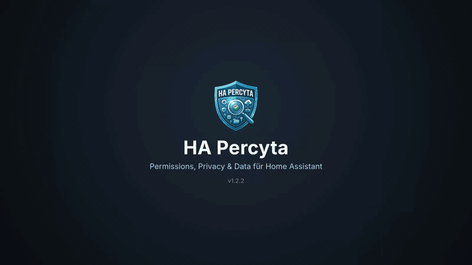

<p align="center">
  
</p>

<h1 align="center">HA Percyta</h1>

<p align="center">Home Assistant Permissions, Privacy &amp; Data Scanner</p>

<p align="center">
  <a href="https://hacs.xyz"></a>
  <a href="https://github.com/jayjojayson/HA_Percyta/releases"></a>
  <a href="https://github.com/jayjojayson/HA_Percyta/actions/workflows/validate.yml"></a>
  <a href="https://github.com/jayjojayson/HA_Percyta/releases"></a>
  <a href="https://github.com/jayjojayson/HA_Percyta/blob/main/LICENSE"></a>
  <a href="README_de.md"></a>
  <a href="../README.md"></a>
</p>

**Integration für Home Assistant** – scannt **lokal** alle Integrationen, Apps,
Custom-Cards, Blueprints, Benutzer, Tokens sowie gespeicherte API-Keys/Secrets und
bewertet die System-Zugriffe (GPS, Kamera, Root/Supervisor …). Seit **v1.1.x** werden
zusätzlich **Speicherplatz, CPU- und RAM-Auslastung** erfasst. Seit **v1.2.2** ist Percyta auch ein
**Wartungs-Werkzeug**: Pflege-Center, Automations-Befunde und Datenbank-Werkzeuge machen es möglich, das
komplette Home-Assistant-System in einem Panel zu sichten, aufzuräumen und zu pflegen.

> Läuft vollständig **innerhalb** von Home Assistant und liest alle Daten direkt über
> das interne `hass`-Objekt. **Es wird kein Token und keine URL benötigt.**
> Scans **lesen** ausschließlich. Verändert wird nur etwas über die **Aktions-Buttons** aus v1.2.2
> (Datenbank-Werkzeuge, verwaiste Entitäten entfernen, Tokens widerrufen, Automationen ein/aus) –
> und nur, wenn du sie selbst startest, mit Bestätigung und (wo nötig) Sicherung vorher.

## Demo-Video (30 s)

<p align="center">
  
  <br><sub>Demo (in voller Qualität: <a href="percyta_demo.mp4">docs/percyta_demo.mp4</a>) – Pflegebedarf mit „Warum?“, Pflege-Center, kompakte Box-Liste, Automations-Befunde, Datenbank aufräumen mit Live-Fortschritt, Log-Fehler mit Diagnose, abgesicherte Secrets</sub>
</p>

## Screenshots

<p align="center">
  
  <br><sub>Übersicht: Kennzahlen, Risiko-Verteilung und alle Bereiche auf einen Blick</sub>
  <br><br>
  
  <br><sub>Speicher &amp; System: Festplatte, RAM, CPU und die größten Speicher-Verbraucher</sub>
  <br><br>
  
  <br><sub>Globale Suche über alle Tabellen und Bereiche</sub>
  <br><br>
  
  <br><sub>Bestand &amp; Integrationen mit Risikobewertung und manueller Anpassung</sub>
</p>

## Features

- **🧭 Reports** – macht aus dem Scan eine To-do-Liste: Jeder Befund kommt mit
  **Beobachtung, möglicher Ursache, Auswirkung und Schritt-für-Schritt-Anleitung** sowie einem
  Button, der an die passende Stelle in Home Assistant springt. Ein Klick auf einen Befund öffnet
  die **Detailansicht** (Diagnose, betroffene Objekte, technische Daten, voriger/nächster Befund).
  Befunde mit gemeinsamer Ursache werden zusammengefasst (z. B. eine nicht laufende Integration statt
  dutzender einzelner nicht verfügbarer Entitäten) und nach Schwere sortiert. Abgedeckt:
  - **Sicherheit & Datenschutz** – ungenutzte Langzeit-Tokens, Integrationen mit hohem Risiko, Apps
    mit weitreichenden Rechten, gespeicherte Zugangsdaten (Hinweis), Backup fehlt/veraltet.
  - **🤖 Automationen & Skripte** (neu in 1.2.2) – beantwortet *„Welche Automationen laufen nicht – und warum?“*:
    - **Konfiguration ungültig** – Home Assistant hat sie beim Laden abgelehnt (inkl. genauer
      Fehlermeldung, z. B. fehlendes Blueprint oder falsch geschriebener Auslöser); sie ist „nicht
      verfügbar“ und läuft nie.
    - **Fehler beim Ausführen** – der letzte Lauf ist mit einem Fehler abgebrochen (aus den gespeicherten
      Ablaufverfolgungen: Meldung, fehlerhafter Schritt, Zeitpunkt; Link direkt zum Trace).
    - **Ausführung übersprungen** – ausgelöst, während sie noch lief (Modus `single`/max erreicht),
      Auslöser gingen verloren.
    - **Problematische Verweise** – je Automation/Skript: Entitäten, die **nicht existieren**,
      **deaktiviert**, **verwaist** oder **nicht verfügbar** sind, gelöschte **Geräte** und **Bereiche**,
      **unbekannte Aktionen** (z. B. gelöschtes Skript, deinstallierte Integration) sowie Entitäten in
      **Templates** (`states('…')`, `is_state(…)`, `states.domain.objekt` …) – jeweils mit Teil
      (Auslöser, Bedingung, Aktion) und genauer Fundstelle. Fehlende Entitäten verlinken auf den
      passenden Befund *Defekte Referenz*.
    - **Ausgeschaltet** – Automationen, die aus sind und deshalb nie laufen.
    - **Seit über 90 Tagen nicht ausgelöst** – jetzt mit dem Grund aus den Traces, wenn der Auslöser
      zwar feuerte, die Bedingungen ihn aber blockiert haben.
  - **Defekte Verweise** – Automationen/Skripte, die auf nicht existierende Entitäten zeigen
    (mit genauer Fundstelle in der Konfiguration), Integrationen, die nicht laufen.
  - **Ungenutzt & verwaist** – nicht verfügbare Entitäten je Integration, verwaiste Entitäten
    (noch registriert, nicht mehr bereitgestellt).
  - **Speicher & Wartung** – Speicher fast voll, Datenbank-Hotspots, **Datenleichen in der Datenbank**
    (Verlauf/Statistik von Entitäten, die es nicht mehr gibt), verfügbare Updates.
  - **Verwalten:** als *erlaubt* markieren, *zurückstellen* (7/30/90 Tage), *ausblenden* oder
    *wieder öffnen* – für einzelne Befunde oder eine ganze Auswahl, optional mit Notiz. Der Status
    wird **nur in HA Percyta** gespeichert; in Home Assistant wird nichts verändert. Ein aufklappbarer Hinweis
    *„Was bedeuten Offen, Erlaubt, Zurückgestellt und Ausgeblendet?“* in der Box erklärt jeden Status: **Offen** = neu oder
    weiter bestehend; **Erlaubt** = geprüft und bewusst akzeptiert, zählt nicht mehr als offen, wird aber bei jedem Scan
    weiter geprüft; **Zurückgestellt** = für 7/30/90 Tage beiseitegelegt, danach wieder offen, falls das Problem noch
    besteht; **Ausgeblendet** = ausgeblendet, bis du ihn wieder öffnest. Ist ein Problem wirklich behoben, verlässt der
    Befund beim nächsten Scan jeden Status und steht unter *Zuletzt behoben*.
  - **Betroffene Objekte** in den Befund-Details: Die **ID ist anklickbar** – Entitäten öffnen ihren
    Detail-Dialog in Home Assistant (Einstellungen, Verlauf), Geräte und Bereiche ihre HA-Seite; ein
    **Kopier-Button** kopiert die ID. *In Home Assistant öffnen* und die ID-Links sind echte Links – Rechtsklick
    oder Strg/Cmd-Klick öffnet sie in einem neuen Tab (bei Entitäten deren Verlauf), so bleibst du in HA Percyta.
  - **Zuletzt behoben (letzte 30 Tage)** – jeder Eintrag ist **anklickbar** (neu in 1.2.2): Er zeigt,
    was das Problem war, die betroffenen Objekte *wie sie damals waren* inkl. Spalte **„Jetzt“** mit dem
    aktuellen Zustand, die technischen Daten und einen **Verlauf** (erstmals beobachtet → welche Objekte
    im Lauf der Zeit hinzukamen oder behoben wurden → behoben) sowie die Dauer. Offene Befunde haben
    denselben Reiter **Verlauf**.

- **🧽 Pflege-Center** – die Wartungs-Ansicht deines Systems: ein **Pflegebedarf** in Prozent (0 % = alles
  in Ordnung) im Verhältnis zur Größe deiner Installation mit Aufschlüsselung per *„Warum?“*, eine Kachel
  pro Thema (Datenleichen, verwaiste Entitäten und Geräte, nicht verfügbare Entitäten, Integrationen mit
  Fehler, Automations-Probleme, Befunde, Tokens, Reparaturen, Log-Fehler, Updates, letztes HA-Backup und letzte
  Percyta-Sicherung mit Größe, Datenbank, Konfigurationsprüfung) und direkte Aktionen. Siehe [Pflege-Center](#-pflege-center-v122).
- **❗ Wichtige Fehler** – Fehler und kritische Meldungen aus dem HA-System-Log; jeder Eintrag ist
  anklickbar und zeigt die betroffene Integration, eine mögliche Ursache und Lösungsvorschläge. Siehe
  [Wichtige Fehler mit Diagnose](#-wichtige-fehler-mit-diagnose-v122).
- **Integrationen** – alle Config-Entries mit Zustand, Quelle, Custom-Flag, IoT-Klasse,
  Abhängigkeiten, Entitäten- und Geräte-Anzahl. Ein Klick auf die Entitäten-/Geräte-Zahl
  führt direkt zur passenden gefilterten Ansicht in Home Assistant.
- **API-Keys & Secrets** – erkennt in den Integrationsdaten hinterlegte Keys/Tokens/
  Passwörter (die Zugangsdaten, die Integrationen bei der Einrichtung speichern, inkl.
  verschachtelter OAuth-Tokens – nicht die `secrets.yaml`). **Abgesichert in 1.2.2:**
  - Werte werden **immer serverseitig maskiert** (feste Länge, höchstens die letzten 2–4 Zeichen) –
    Klartext gelangt nie in Scan-Daten, Markdown-Report, Sensoren/Attribute, Recorder oder HTML-Export.
  - **Anzeigen** / **Kopieren** holen einen einzelnen Wert auf Klick über einen WebSocket-Befehl nur
    für Admins; lesbar sind ausschließlich als Secret erkannte Felder (keine beliebige Konfiguration).
    Max. 10 Abrufe je Minute und Benutzer; jeder Abruf wird **protokolliert** (wer, wann, welches Feld –
    nie der Wert) und ist in der Box unter *„Protokoll: Abrufe von Secrets“* sowie im HA-Log sichtbar.
  - Ein angezeigter Wert **verschwindet nach 20 Sekunden**, beim Anzeigen eines anderen Werts, beim
    Neuaufbau oder Verlassen des Panels und wenn der Browser-Tab in den Hintergrund geht. *Kopieren*
    legt den Wert in die Zwischenablage, ohne ihn anzuzeigen.
  - Das Panel fügt Daten nie als HTML ein (keine `innerHTML`-Sinks, nur Text), und Links aus den
    Scan-Daten werden nur geöffnet, wenn sie interne HA-Pfade oder `http(s)` sind – `javascript:` u. Ä.
    werden ignoriert. Die Klartext-Anzeige lässt sich in den Optionen **komplett abschalten**.
- **Apps** – über die Supervisor-API: welche Apps haben `full_access`,
  `privileged`, Host-Netzwerk, Docker-API, GPIO/USB, Supervisor-Rolle usw. – inkl.
  Laufzeit-Ressourcen (CPU/RAM je App).
- **System-Zugriff-Analyse** – braucht eine Integration/App GPS, Kamera, Netzwerk,
  Datenbank oder gar Root-/Systemrechte?
- **💾 Speicher & System** – Gesamtspeicher (belegt/frei), RAM- und Swap-Nutzung,
  CPU-Auslastung + Load Average, **Systemspeicher nach Kategorie** (System, Apps,
  Medien, Backups … via Supervisor, inkl. Summe aller Custom Cards) sowie eine Aufschlüsselung der größten
  Speicher-Verbraucher unter `/config` (Recorder-Datenbank, Backups, Custom Components,
  Medien, www …) inkl. Speicherbedarf je Custom-Integration.
- **🗄️ Datenbank (Recorder)** – welche Entitäten die Datenbank am stärksten füllen (Zeilen je
  Entität und je Statistik, Top 30, Klick öffnet den Verlauf; Auswertung höchstens 1× pro Stunde).
  - **🛠️ Datenbank bearbeiten** (neu in 1.2.2) – siehe [Datenbank-Werkzeuge](#datenbank-werkzeuge).
  - **🧟 Datenleichen** – Entitäts-IDs mit Verlauf/Statistik in der Datenbank, die es in Home
    Assistant nicht mehr gibt, mit Zeilenzahl; auswählen und gesammelt löschen.
- **Custom Cards** – alle Lovelace-Ressourcen (Custom-Card-URLs) inkl. Speichergröße
  (über den Dateipfad ermittelt; bei HACS-Karten die Ordnergröße).
- **Blueprints** – alle registrierten Automation-/Script-Blueprints inkl. Dateigröße.
- **Benutzer & Tokens** – Owner/Admin, Gruppen, Long-Lived-Tokens inkl. letzter Nutzung.
- **Risikobewertung** – automatische Einstufung 🟢 Low / 🟡 Medium / 🔴 High, inkl.
  ausklappbarer Erklär-Card („Warum?“), die die aktuelle Verteilung datenbasiert begründet.
  Die Einstufung lässt sich pro Integration **manuell überschreiben** (Auswahl „Anpassen“
  in der Integrationen-Tabelle, z. B. wenn ein Wetterdienst nur wegen einer Kamera-Entität
  fälschlich als High gilt). Die Änderung ist sofort sichtbar (Tabelle und Zähler); davon abhängige Befunde
  folgen mit einem Scan im Hintergrund.
- **Sensoren & Button** – Kennzahlen als Sensoren (inkl. CPU-, RAM- und
  Speicher-Auslastung), manueller Scan per Button.
- **Report-Panel** – Boxen als kompakte Liste in Gruppen, umschaltbar zwischen voller Bildschirmbreite
  und schmaler Ansicht, sortierbare Tabellen, globale Suche über alle
  Tabellen (inkl. der Box *Reports*; die *Reports*-Box im Pflege-Center bleibt davon unberührt) sowie Umschalter für Einzel-/Akkordeon-Modus und „Alle ein-/ausklappen“.
  Oberfläche **mehrsprachig (DE/EN)** – folgt automatisch der HA-Sprache.
- **Neu seit letztem Scan** – neue Integrationen/Apps/Custom-Cards/Blueprints/Benutzer
  werden markiert (Badge/„NEU“). Sensor **„Neue Funde“** und Event
  `ha_percyta_new_findings` ermöglichen Automationen.
- **Auto-Scan** – optional in konfigurierbarem Intervall.
- **Markdown-Report** – optionaler Datei-Export je Scan.

## Installation

### HACS (empfohlen)

[](https://my.home-assistant.io/redirect/hacs_repository/?owner=jayjojayson&repository=HA_Percyta&category=integration)

Oder `https://github.com/jayjojayson/HA_Percyta` in HACS manuell als benutzerdefiniertes Repository (Kategorie *Integration*) hinzufügen, **HA Percyta** installieren und Home Assistant neu starten.

### Manuell

1. Ordner `custom_components/ha_percyta` nach `/config/custom_components/` kopieren:
   ```bash
   cp -r custom_components/ha_percyta /config/custom_components/
   ```
2. Home Assistant **neu starten**.
3. **Einstellungen → Geräte & Dienste → + Integration hinzufügen → HA Percyta**.
4. Optionen wählen (alle mit sinnvollen Vorgaben) und speichern.

> **Hinweis:** HA Percyta benötigt keine zusätzlichen Python-Pakete. Für exakte CPU-/RAM-
> Werte wird `psutil` genutzt, falls es bereits im HA-System vorhanden ist – andernfalls
> greift ein integrierter Fallback (`/proc`, `shutil`).

## Optionen

| Option | Bedeutung | Standard |
|---|---|---|
| Apps einbeziehen | Apps via Supervisor scannen (nur bei HA OS/Supervised) | ✅ |
| API-Keys erkennen | Secrets in Integrationsdaten aufspüren | ✅ |
| Fehler aus System-Log | Wichtige Fehler (keine Warnungen) aufnehmen | ✅ |
| Speicher, CPU & RAM analysieren | System-/Speicher-Auslastung erfassen | ✅ |
| Klartext-Anzeige von Secrets erlauben | Admins dürfen im Panel einzelne Secrets anzeigen/kopieren (protokolliert). Überall sonst sind Werte immer maskiert. | ✅ |
| Report schreiben | Markdown-Report je Scan speichern (die letzten 20 bleiben erhalten) | ✅ |
| Ausgabeverzeichnis | Ziel der Report-Dateien | `custom_components/ha_percyta/output` |
| Auto-Scan | Regelmäßig automatisch scannen | ❌ |
| Intervall | Sekunden zwischen Auto-Scans (min. 300) | 3600 |

Die Optionen lassen sich jederzeit über **Konfigurieren** an der Integration ändern.

## Verwendung

- **Report direkt in HA:** In der Seitenleiste erscheint der Eintrag **„HA Percyta“** –
  dort wird der Bericht in einer modernen Ansicht über die **volle Bildschirmbreite** mit
  Stat-Karten, Risiko-Verteilung und einklappbaren Abschnitten angezeigt (keine MD-Datei
  nötig). Die Boxen stehen als **kompakte Liste in zwei Gruppen** – *Sicherheit & Datenschutz*
  und *System & Details*: je Zeile ein Home-Assistant-Icon, der Titel, eine Kernaussage (z. B.
  „182 installiert · 14 eigene“) und rechts ein farbiger Status. Ein Klick klappt den Inhalt
  direkt darunter auf.
  - **Ansicht-Umschalter:** *Einzeln* (mehrere Boxen offen), *Akkordeon* (Öffnen schließt
    die vorherige Box), *Breit/Schmal* (volle Breite ↔ zentrierte schmale Ansicht) und
    *Alle ein-/ausklappen*. Die Auswahl wird gemerkt.
  - **Globale Suche:** Das Suchfeld filtert über alle Tabellen; Boxen mit Treffern öffnen
    sich automatisch, leere werden ausgeblendet.
  - **Sortierbare Tabellen:** Klick auf einen Spaltenkopf sortiert auf-/absteigend.
  - Buttons für *Neu scannen* und **Download als MD/HTML** sowie ein Button rechts im
    Header zum Ein-/Ausblenden der HA-Seitenleiste sind eingebaut.
  - **Automatischer Scan beim Öffnen:** Beim Aufruf des Panels über die Seitenleiste wird
    automatisch ein frischer Scan ausgeführt; danach greift man bei Bedarf manuell über
    *Neu scannen* ein.
- **🧭 Reports:** die dritte Box des Reports (nach *Speicher & System* und *Bestand & Zustand*). Die Kategorie-Kacheln filtern die Liste, die Reiter
  wechseln zwischen *Offen / Erlaubt / Zurückgestellt / Ausgeblendet*. Befunde ankreuzen (oder
  *Seite auswählen*) und mit den Buttons über der Liste gesammelt bearbeiten. Ein Klick auf einen
  Befund öffnet die Detailansicht; *Esc* oder der Zurück-Button bringt dich genau an die Stelle zurück,
  an der du warst (offene Boxen, Scroll-Position).
  **Grenzen und Annahmen:** Verweise werden für Automationen und Skripte geprüft
  (Entity-IDs unter `entity_id`, Blueprint-Eingaben, `device_id`, `area_id`, Aktionen und gängige
  Template-Funktionen) – nicht für Szenen oder Dashboards. Fehler und übersprungene Läufe stammen aus
  den Ablaufverfolgungen, die Home Assistant je Automation/Skript vorhält (standardmäßig die letzten 5 Läufe).
  Schwellen: 90 Tage ohne Auslösung, Token nie genutzt (14 Tage Schonfrist), Backup älter als 7 Tage,
  Speicher ≥ 85 %, eine Datenbank-Entität mit ≥ 10 % aller Zustandszeilen (mind. 50.000). Befunde
  erscheinen nur, wenn ihre Datenquelle im Scan lesbar war; die Verweis-Prüfung entfällt, solange
  Home Assistant noch startet.
- **💾 Speicher & System:** eigener Abschnitt mit Karten für Speicher-Belegung, freien
  Speicher, RAM und CPU, dem Systemspeicher nach Kategorie sowie der Aufschlüsselung der
  größten Verbraucher.
- **Cloud-Datenfluss:** eigener Abschnitt, welche Integrationen Daten an externe/Cloud-Dienste
  senden.
- **Token-Hygiene:** Long-Lived-Tokens, die nie oder lange (> 90 Tage) nicht genutzt wurden,
  werden markiert (Kandidaten zum Widerrufen) – inkl. Sensor *„Ungenutzte Tokens“*.
- **Scan-Intervall am Gerät:** Auf der Geräteseite gibt es das Auswahlfeld
  **„HA Percyta Scan-Intervall“** mit *Manuell / Stündlich / Täglich / Wöchentlich / Monatlich*.
  Die Sensoren **„Letzter Scan“** und **„Nächster Scan“** zeigen transparent, wann der
  nächste automatische Lauf ansteht.
- **Button „HA Percyta Scan starten“** löst einen Scan sofort aus.
- **Sensoren:** Sicherheitsfunde, **offene Befunde**, Integrationen, Apps, API-Keys & Secrets,
  CPU-Auslastung, RAM-Auslastung, Speicher-Belegung und freier Speicher
  (mit Detail-Attributen wie High-Risk-Domains, Root-Apps oder Gesamt-/Frei-GiB).
- **Services:**
  | Service | Beschreibung |
  |---|---|
  | `ha_percyta.scan` | Scan ausführen, liefert Kennzahlen + Report-Pfad als Response |
  | `ha_percyta.export` | Aktuellen Report als Markdown-Text (Response) zurückgeben |

### Secrets im Klartext auslesen

Öffne die Box **🔐 API-Keys, Tokens & Secrets** und klicke neben dem Feld auf **Anzeigen**
(20 s sichtbar) oder **Kopieren**. Das geht nur für Admins, ist begrenzt und wird protokolliert.
Seit 1.2.2 steht der Klartext **nicht mehr** im Report oder in den Service-Antworten – die frühere
Option „Secrets maskieren“ wurde durch **„Klartext-Anzeige von Secrets erlauben“** ersetzt.

### Datenbank-Werkzeuge

Öffne **🗄️ Datenbank (Recorder) → 🛠️ Datenbank bearbeiten** oder nutze das **⋯**-Menü in einer Tabellenzeile.

Entitäten wählst du über ein **durchsuchbares Dropdown** aus (beim Löschen mit Mehrfachauswahl): Es
listet jede ID mit Daten in der Datenbank, nach Größe sortiert, mit Name, Anzahl Zustände/Statistikzeilen
und Kennzeichen (*ohne Entität*, *verwaist*, *deaktiviert*, *nicht aufgezeichnet*). Schnellfilter
(Datenleichen, Verwaist, Mit Statistik, Nicht aufgezeichnet), ein Domain-Filter und *„Alle Treffer
auswählen“* machen das Aufräumen in einem Rutsch einfach.

> ⚠️ **Änderungen an der Datenbank sind endgültig.** Ist die Datenbank beschädigt, startet Home
> Assistant nicht mehr richtig. Jede Aktion bietet deshalb **vorher eine Sicherung** an (Standard) –
> schlägt sie fehl, wird nichts verändert. Es läuft immer nur eine Aktion; während einer
> Datenbank-Migration gar keine. Alles landet im **Protokoll**.

| Werkzeug | Was es tut | Wie (nur offizielle Wege von Home Assistant) |
|---|---|---|
| 🔁 **Entität ersetzen** | Gerätetausch: Die **neue Entität übernimmt die ID der alten**, Verlauf und Langzeitstatistik (z. B. Energie-Dashboard) laufen nahtlos weiter. | Sicherung → alte Entität aus der Entitäten-Registry entfernen → neue Entität auf die alte ID umbenennen → optional den kurzen eigenen Verlauf der neuen Entität löschen. |
| ✏️ **Umbenennen** | Benennt eine Entität samt Verlauf und Statistik auf eine **freie** ID um. Geht auch nur für den Verlauf (Entität gibt es nicht mehr). | Umbenennen in der Entitäten-Registry (der Recorder zieht die Daten mit) bzw. `async_update_states_metadata` / Statistik-Metadaten. |
| 🗑️ **Daten löschen** | Drei getrennte Häkchen: **Verlauf** (Zustände & Ereignisse), **Kurzzeitstatistik** (5-Minuten-Werte) und **Langzeitstatistik** (Stundenwerte, z. B. Energie-Dashboard – standardmäßig aus). Alles oder **nur Daten älter als 7/30/90/365 Tage**. | `recorder.purge_entities` (`keep_days`), die Statistik-Löschfunktion des Recorders bzw. – für nur eine Tabelle oder einen Zeitraum – eine Recorder-Aufgabe im Recorder-Thread, genau wie Home Assistant selbst Zeiträume löscht. Die Metadaten bleiben, damit z. B. die Langzeitstatistik weiterläuft. |
| 🧹 **Aufräumen** | Löscht sofort alle Zustände, Ereignisse und Kurzzeitstatistiken der ganzen Datenbank, die älter als N Tage sind, und kann sie danach **verkleinern** (repack/VACUUM). Langzeitstatistiken bleiben. Eine **Vorschau** zeigt vorher, wie viele Zeilen je Datenart gelöscht werden, die am meisten betroffenen Entitäten und den ungefähren Platz. | `recorder.purge` (`keep_days`, `repack`). |
| 👻 **Verwaiste Entitäten** | Entfernt Einträge aus der Entitäten-Registry, die keine Integration mehr bereitstellt – optional samt Verlauf und Statistik. Aktive Entitäten sind gesperrt. | Entitäten-Registry `async_remove` (+ Purge). Die Registry steckt im HA-Backup, nicht in der Datenbank-Kopie. |
| 💾 **Sicherungen** | Kopie der SQLite-Datenbankdatei (konsistente Online-Kopie, geprüft mit `PRAGMA quick_check`, die letzten 2 bleiben in `/config/ha_percyta_db_backups`) oder ein Home-Assistant-Backup. Zeigt Datenbankgröße, benötigten und freien Speicher; **„Vorhandene Percyta-Kopie ersetzen“** löscht bei knappem Speicher zuerst die alte Kopie. | SQLite-Backup-API · `hassio.backup_partial`/`backup_full` bzw. `backup.create_automatic`. |
| 📜 **Protokoll** | Wer hat wann was gemacht (inkl. Abrufe von Secrets). | Gespeichert in `.storage/ha_percyta_audit`. |

**Fortschritt & Hintergrund:** Jede Datenbank-Aktion läuft als **Hintergrund-Auftrag in Home Assistant**.
Der Dialog zeigt den aktuellen Schritt (z. B. *Sicherung: Datenbank wird kopiert*), einen Fortschrittsbalken
mit Prozent, die bisherige Dauer und eine Schätzung der Restzeit; **„Details (Protokoll)“** öffnet ein
Protokoll im Terminal-Stil mit jedem Schritt (gezählte Zeilen, Sicherung kopiert und geprüft, verbleibende
Zeilen, während der Recorder in Etappen löscht). Du darfst das **Fenster schließen** – die Aktion läuft
weiter. Eine Anzeige oben in der Leiste (⏳ … %) zeigt den Fortschritt und öffnet das Fenster jederzeit wieder.

Vor dem Ausführen lädt die **Vorschau** automatisch, sobald du Entitäten auswählst. Sie zeigt je ID die Anzahl der
Zustände und Statistikzeilen, den Zeitraum je Datenart (Verlauf, Lang- und Kurzzeitstatistik), die Einheit und den
aktuellen Zustand – beim Löschen zusätzlich den **frei werdenden Platz (ca.)** je Zeile und insgesamt – plus Warnungen (z. B. *abweichende Einheit*,
*alte Entität noch aktiv*, *neue Entität ohne `state_class`*, *Ziel hat schon Daten*). **Ausführen**
wird erst aktiv, wenn du bestätigst, dass die Änderung nicht rückgängig zu machen ist.

> **Zur Platz-Schätzung:** Es ist ein grober Durchschnitt (Datenbankgröße ÷ Zeilenzahl). Gelöschte Zeilen geben
> Platz *in* der Datenbank frei; die Datei selbst wird erst kleiner, wenn sie verkleinert wird – mit dem Werkzeug
> *Aufräumen* und *Verkleinern* oder durch die automatische Verkleinerung des Recorders am zweiten Sonntag im Monat
> (`auto_repack`, standardmäßig an).

**Zu wenig Speicher?** Die Sicherungs-Auswahl zeigt Datenbankgröße, benötigten und freien Speicher.
Reicht der Platz nicht für eine zusätzliche Kopie, wird *„Vorhandene Percyta-Kopie ersetzen“*
vorgeschlagen (die alte Kopie wird nur gelöscht, wenn der Platz danach reicht). Scheitert eine Sicherung
trotzdem am Speicher, listet das Fenster die vorhandenen Percyta-Kopien mit **Löschen**-Button und bietet
*Vorhandene Kopie ersetzen* oder *HA-Backup verwenden* an – geändert wurde bis dahin nichts. Tipp: Alte
Percyta-Kopien in `/config/ha_percyta_db_backups` zu löschen gibt Speicher frei.

**Auswahl & Vorschau:** Jedes Fenster mit Vorauswahl (z. B. *verwaiste Entitäten*, *Datenleichen*,
*verwaiste Geräte*) hat neben den gewählten Einträgen einen Button **„Alle abwählen“**. Über der Auswahl
wechselt der Button **☰ Liste / ▦ Kacheln** (oben rechts) zwischen kompakten Kacheln und einer **Liste** mit Name,
ID und Zustand – so lassen sich lange Auswahlen schnell sichten und einzelne Einträge mit × herausnehmen; ab 8
gewählten Einträgen filtert ein Suchfeld die Liste. Die Ansicht wird gemerkt. Die Vorschau
behält beim Laden die bisherige Tabelle, zeigt einen Hinweis, wenn noch nichts ausgewählt ist, und
übernimmt eine eingetippte, noch nicht mit Enter bestätigte ID.

**Datenbank-Kopie zurückspielen:** Home Assistant stoppen, die Datei aus
`/config/ha_percyta_db_backups/` nach `/config/home-assistant_v2.db` kopieren, Home Assistant starten.
Bei einer externen Datenbank (MariaDB/PostgreSQL) gibt es keine Datei-Kopie – mit Supervisor wird ein
Voll-Backup erstellt, sonst bitte die Datenbank selbst sichern.

### 🧽 Pflege-Center (v1.2.2)

**Oben im Bericht** stehen zwei Karten nebeneinander: links **Risiko & Datenschutz** (Risiko-Verteilung
plus die Sicherheits- und Datenschutz-Kennzahlen – hier zählen nur *Sicherheits-Befunde*, alle anderen
Befunde stehen im Pflege-Center), rechts eine kompakte **Vorschau des Pflege-Centers** mit dem Ring
**Pflegebedarf**, einer Zeile pro Thema (Anzahl oder grünes ✓ – ein Klick öffnet direkt die passende
Aktion) und Schnell-Links zu *Befunde*, *Datenbank*, *Entität ersetzen*, *Daten löschen* und *Protokoll*.
**„Pflege-Center öffnen“** führt auf eine eigene Seite mit allen Kacheln, der Box **Reports** (dieselbe
Befunde-Box wie auf der Hauptseite), den Datenbank-Werkzeugen, einer laufenden Aktion und den letzten Aktionen.

**Pflegebedarf (0–100 %).** Der Ring zeigt, wie viel zu tun ist – **0 % = alles in Ordnung** (grüner
Ring); je höher der Wert, desto mehr Pflege braucht dein System. Die Farbe richtet sich nach dem Wert:
bis 10 % grün, bis 35 % gelb, bis 60 % orange, darüber rot. **„Warum?“** zeigt, wie der Wert entsteht.
Jeder Bereich wird **im Verhältnis zur Größe deiner Installation** bewertet und hat ein festes
Höchstgewicht (zusammen 100 Punkte):

| Bereich | Max. Punkte | Volles Gewicht ab |
|---|---|---|
| Nicht verfügbare Entitäten | 20 | 20 % aller Entitäten |
| Integrationen mit Fehlern | 15 | 10 % aller Integrationen |
| Automationen/Skripte mit Problemen | 15 | 20 % aller Automationen + Skripte |
| Verwaiste Entitäten + Geräte | 10 | 5 % der Entitäten/Geräte |
| Speicherbelegung | 10 | zählt ab 80 %, voll bei 95 % |
| Datenleichen in der Datenbank | 5 | 20 % aller Zeilen |
| Alter des letzten Backups | 5 | zählt ab 7 Tagen, voll bei 30 Tagen (oder kein Backup) |
| Veraltete Tokens | 5 | 25 % aller Tokens |
| Offene Reparaturen | 5 | 10 |
| Fehler im Log | 5 | 20 |
| Ausstehende Updates | 5 | 10 |

Die Gewichtung ist eine Faustregel von HA Percyta, kein offizieller Home-Assistant-Wert.

Die Pflege-Center-Seite zeigt je eine Kachel pro Thema – mit Anzahl, einem Satz Erklärung und einem Button:
**Datenleichen in der Datenbank**, **verwaiste Entitäten**, **verwaiste Geräte**, **nicht verfügbare
Entitäten**, **Integrationen mit Fehler**, **Automationen mit Problemen**, **ausgeschaltete
Automationen**, **Befunde (Reports)**, **ungenutzte Tokens**, **Datenbank** (Größe/Aufräumen), **letztes HA-Backup**
(Größe des letzten Backups, Alter in der Beschreibung), **letzte Percyta-Sicherung** (Größe und Alter der neuesten
Datenbank-Kopie von HA Percyta, Anzahl der Kopien und belegter Speicher in `/config/ha_percyta_db_backups` – diese
steht auch in der Vorschau auf der Übersicht), **offene Reparaturen**,
**wichtige Fehler im Log**, **Konfiguration prüfen** (dieselbe Prüfung wie vor einem Neustart – ändert
nichts) und **verfügbare Updates**. Grüne Kacheln zeigen *„Alles sauber“*. Nach einer Aktion aktualisieren sich die Zahlen von selbst, sobald der neue Scan
fertig ist (oben: *„Daten werden aktualisiert …“*). Die **Zurück-Taste** der Maus/des Browsers führt vom Befund zurück ins
Pflege-Center und von dort zur Übersicht. *Automationen mit Problemen* zählt jede Automation/jedes Skript einmal – nur
offene Befunde mit Schweregrad hoch/mittel; ausgeschaltete Automationen zählen nicht. Jeder Button öffnet zuerst nur ein
Fenster mit Erklärung („Was passiert?“) und Vorschau – geändert wird erst nach deiner Bestätigung.

### ❗ Wichtige Fehler mit Diagnose (v1.2.2)

Jeder Eintrag unter **❗ Wichtige Fehler** ist anklickbar. Das Fenster zeigt die vollständige Meldung,
Quelle, Logger, Anzahl, erstes/letztes Auftreten und – falls vorhanden – das Ende des Tracebacks.
HA Percyta erkennt die **betroffene Integration** (Home Assistant oder eigene/HACS) und ordnet den
Fehler mit einfachen Regeln ein: *Abhängigkeit*, *Anmeldung (401/403)*, *Erreichbarkeit
(Zeitüberschreitung/Verbindung)*, *Entität*, *Programmfehler*, *Einrichtung*, *Datenabruf*, *Template*,
*eigene Integration* oder *unklar*. Zu jeder Einordnung gibt es eine kurze **mögliche Ursache** und
konkrete **Schritte** sowie Buttons: *Integration öffnen*, *Integration neu laden*, *Protokolle öffnen*
und *Meldung kopieren*. Die Diagnose ist eine automatische Einschätzung des Fehlertexts und kann
danebenliegen. Werte wie `api_key=…`, `token=…` oder `password=…` werden in den Log-Texten unkenntlich gemacht.

### Weitere Aktionen (v1.2.2)

- **Nicht verfügbare Entitäten deaktivieren oder entfernen** – *Deaktivieren* ist umkehrbar (Einstellungen ›
  Entitäten). *Aus Home Assistant entfernen* löscht die Entität aus der Entitäten-Registry, genau wie **„Löschen“** in
  den Entitäts-Einstellungen von Home Assistant – sie verschwindet damit auch unter ihrem Gerät; optional werden
  Verlauf und Statistik mit gelöscht, als Sicherung ist ein HA-Backup vorausgewählt (die Registry steckt darin). Stellt
  die Integration die Entität noch bereit, legt sie sie beim nächsten Neuladen oder Neustart wieder an – dann besser
  deaktivieren. Entitäten ohne Registry-Eintrag (meist YAML) werden gemeldet und lassen sich nur in der Konfiguration
  entfernen.
- **Integrationen neu laden**, die nicht laufen – aus dem Pflege-Center oder dem Befund. Der Name und **Öffnen ↗**
  führen direkt zur Integration in Home Assistant (dort stehen die genaue Fehlermeldung, Neu-Konfigurieren und
  Löschen). In Home Assistant ignorierte Entdeckungen zählen nicht – sie waren nie eingerichtet.
- **Verwaiste Geräte entfernen** – Geräte, deren Integration es nicht mehr gibt (neuer Befund *Verwaiste
  Geräte*); Geräte einer noch eingerichteten Integration sind gesperrt.

- **Zugriffstokens widerrufen** – Button in der Tabelle *Access Tokens* und im Befund *Ungenutzter
  Zugriffstoken*. Der Token deiner eigenen, aktuellen Sitzung ist geschützt. Wird protokolliert.
- **Automationen** – *Einschalten* direkt im Befund *Ausgeschaltete Automationen*; *Jetzt testen*
  (führt die Aktionen ohne Bedingungen aus) und *Ausschalten* in den Automations-Befunden.
- **Abkürzungen in Befunden** – *Datenleichen* → löschen, *Verwaiste Entitäten* → aus der Registry
  entfernen, *Datenbank-Hotspot* → alten Verlauf löschen.

> **Erwarteter Log-Eintrag beim Ersetzen:** Der Recorder schreibt *„Cannot migrate history for
> entity_id … because the new entity_id is already in use“*. Das ist gewollt – genau dadurch schreibt
> die neue Entität im bestehenden Verlauf der alten ID weiter.

## Changelog

Siehe [CHANGELOG_de.md](CHANGELOG_de.md) (English: [CHANGELOG.md](CHANGELOG.md)).

## Risikoklassifizierung

| Stufe | Bedeutung |
|---|---|
| 🟢 Low | Keine externen Zugriffe, keine sensiblen Daten |
| 🟡 Medium | Externer/Cloud-Zugriff, gespeicherte Secrets oder Systembezug |
| 🔴 High | GPS, Kamera oder Root-/System-/Supervisor-Zugriff |

## Hinweis

Scans **lesen** ausschließlich – sie verändern nichts an deiner Installation. Verändert wird nur
etwas über die Aktions-Buttons (Datenbank-Werkzeuge, verwaiste Entitäten, Tokens widerrufen,
Automationen ein/aus), und nur, wenn du sie selbst startest (mit Bestätigung und, wo nötig, Sicherung). Gespeichert werden eigene Daten (Risiko-Overrides, Befund-Status und -Verlauf,
„Zuletzt behoben“, Vergleichsstand für „Neu seit letztem Scan“, Protokoll).
Reports werden lokal im gewählten Ausgabeverzeichnis gespeichert.

